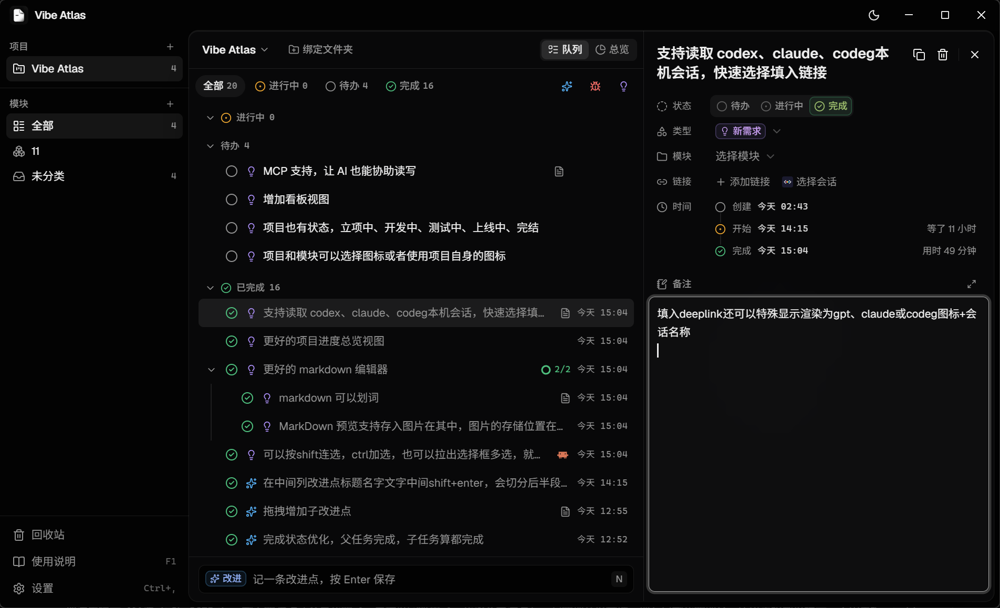

<div align="center">

# Vibe Atlas

**一个人管所有 vibe 项目：想到就记，一条条推进，项目全貌自己长出来。**

`快捷键随手记` · `项目 / 模块 / 改进点` · `复制给 AI` · `自动汇总总览` — 本地桌面软件，Windows 先行。

[](#license)
[](#开发栈)
[](#启动)
[](#核心能力)
[](#使用流程)
[](#配置)

[使用流程](#使用流程) · [核心能力](#核心能力) · [启动](#启动) · [配置](#配置) · [开发栈](#开发栈) · [协同关系](#协同关系)

</div>

> AI 接手前先读 [AGENTS.md](./AGENTS.md)。本 README 是用户视角速览；项目不变量、验证命令和文档分工全在 AGENTS.md。

---

<p align="center">
  
</p>

> 用 AI 写代码时，改进点、bug、新需求总是一起冒出来，记在聊天里很快就找不到了。现在按快捷键随手记一行，之后在队列里挑一条复制给 AI，做完自己打勾，记得越多项目总览越完整。

---

## 核心能力

| 能力 | 实现 |
|---|---|
| **快速记录** | 在任何软件上按 `Ctrl+Alt+Space` 呼出小窗，输入一行回车就存进项目；`Shift+Enter` 展开 Markdown 备注和链接。见 [capture-app.tsx](src/capture-app.tsx) |
| **项目 → 模块 → 改进点** | 改进点分改进、bug、新需求三种，可以挂在模块下，也可以有任意层子改进点；拖动排序、改层级、合并。见 [queue.tsx](src/components/app/queue.tsx)、[数据层](internal/store/README.md) |
| **状态全靠手点** | 待办、进行中、完成随时切换，进行中不限条数，自动记录开始和完成时间；`Ctrl` / `Shift` 多选后批量操作。规则见 [product.md](docs/product.md#规则) |
| **前置与流程图** | 改进点之间可以设先后（B 等 A 做完），队列里标出还在等的；「流程图」视图是自己写的画布：上级和子改进点合成一张卡片，拖动对齐、框选、从圆点拉线（靠近自动吸附）、拉到空白处新建、右键菜单、一键整理、撤回重做。只提示，不改状态。见 [flow/](src/components/flow/)、[deps.go](internal/store/deps.go) |
| **复制给 AI** | 把标题、备注连同子改进点清单复制成一段 Markdown，自己粘贴发送；备注里的图片换成本机路径，AI 能直接读图。见 [atlas.go](atlas.go)、[images.go](images.go) |
| **链接到会话** | 每条改进点可以绑定一个 deeplink；设置了会话来源时，能直接从 Claude Code、Codex、codeg 的本机会话里挑一个。见 [claude_session.go](claude_session.go)、[session-picker.tsx](src/components/app/session-picker.tsx) |
| **Markdown 备注** | 边写边渲染；划词浮出格式工具栏，`/` 斜杠命令插入，`Ctrl+F` 查找替换；粘贴截图或图文混排内容，图片存进数据目录，点开能缩放拖动。见 [editor/](src/components/editor/) |
| **沉浸式编辑** | 备注展开成大窗口：左边大纲、标题折叠、专注模式、打字机滚动、字数统计。见 [immersive-note.tsx](src/components/app/immersive-note.tsx) |
| **项目总览** | 从改进点即时汇总：总进度、各模块进度、类型分布、前置都完成可以开始的、进行中列表、按天的完成记录。见 [overview.tsx](src/components/app/overview.tsx) |
| **回收站** | 删除不弹确认，`Ctrl+Z` 撤销；回收站按天分组，默认保留 30 天。见 [trash.tsx](src/components/app/trash.tsx) |
| **常驻托盘** | 关窗口只是隐藏，老板键一键藏起所有窗口；暗色和亮色主题，可选动态背景、背景图片和毛玻璃。见 [app.go](app.go)、[look-settings.tsx](src/components/app/look-settings.tsx) |

全部功能的细节在 [docs/product.md 的「已实现的功能」](docs/product.md#已实现的功能)。

---

## 启动

### 下载安装

到 [GitHub Releases](https://github.com/Zker67/vibe-atlas/releases) 下载：

| 文件 | 说明 |
|---|---|
| `Vibe-Atlas-<版本>-Setup.exe` | 安装版（推荐），中文安装界面，装在当前用户目录，不需要管理员权限 |
| `Vibe-Atlas-<版本>-Portable.zip` | 便携版，解压后运行 `Vibe Atlas.exe`；数据同样存在 `%AppData%\Vibe Atlas` |

发布页上另外两个文件是自动更新用的，不用下载。之后有新版本时，主窗口右下角会提示「去更新」：点一下，下载完自动重新打开，数据不受影响；也可以在 设置 → 更新 手动检查，或者改成定时检查、不自动检查。

程序没有代码签名，Windows SmartScreen 拦截时点「更多信息」→「仍要运行」。

从源码运行或自己打包需要 Go 和 Bun。

### 本地运行

```bash
git clone https://github.com/Zker67/vibe-atlas.git
cd vibe-atlas
bun install
bun run dev
```

开发模式的数据放在正式数据目录下的 `dev` 子文件夹里，不会碰到正式数据。

### 打包安装

```bash
bun run build
```

产物在 `build/windows-amd64/`：

| 文件 | 说明 |
|---|---|
| `Vibe Atlas.exe` | 免安装版，可以直接运行；复制到别处时把同目录的 `icon.png`、`tray.png` 一起带上 |
| `vibe-atlas-setup-<版本>-amd64.exe` | 安装包 |

自己打包的版本不带更新签名，不会自动更新；带签名打包和发布新版本的步骤见 [docs/operations.md](docs/operations.md#发布新版本)。

### 检查

```bash
bun run typecheck && bun run lint
CGO_ENABLED=0 go vet ./... && CGO_ENABLED=0 go test ./...
bun test tests
```

打包后的冒烟测试和排查方法见 [docs/operations.md](docs/operations.md)。

---

## 使用流程

| 步骤 | 做什么 |
|---|---|
| 1 · 记下来 | 写代码时想到什么，按 `Ctrl+Alt+Space` 输入一行，`Tab` 切换类型，`Enter` 保存，可以连续记 |
| 2 · 整理 | 在主窗口的队列里拖动排序、挂到模块、拖到另一条下面变成子改进点，在右边详情里补备注和链接 |
| 3 · 发给 AI | 挑一条点「开始进行」，按 `C` 复制，粘贴给 Claude Code、Codex 或别的 AI |
| 4 · 打勾 | 做完点行首的圆圈标为完成；父改进点完成时子改进点跟着完成 |
| 5 · 看全貌 | 切到「总览」，看各模块进度和每天完成了什么 |

全部快捷键在软件里按 `F1` 打开使用说明查看，源文件是 [help-dialog.tsx](src/components/app/help-dialog.tsx)。

---

## 配置

设置都在软件里改（`Ctrl+,`），存在数据库里，没有单独的配置文件。

| 设置 | 默认 | 位置 |
|---|---|---|
| 开机自动启动 | 关闭 | 设置 → 常规 |
| 快速记录快捷键 | `Ctrl+Alt+Space` | 设置 → 常规 |
| 老板键 | 不设置 | 设置 → 常规 |
| 主题 | 跟随系统 | 设置 → 外观，或顶栏的外观按钮 |
| 动态背景、背景图片、毛玻璃 | 关闭 | 设置 → 外观 |
| 窗口整体透明度 | 100%（最低 40%） | 设置 → 外观 |
| 子改进点沿用上级的链接 | 打开 | 设置 → 改进点 |
| 会话来源 | 不使用（可选 Claude Code / Codex / codeg） | 设置 → 改进点 |
| 回收站保留天数 | 30 天 | 设置 → 数据 |
| 自动检查更新 | 启动时检查（可选不自动检查、定时检查：每小时 / 每 6 小时 / 每天） | 设置 → 更新 |

环境变量只用于开发和测试：

| 变量 | 默认 | 说明 |
|---|---|---|
| `VIBE_ATLAS_DATA_DIR` | `%AppData%\Vibe Atlas` | 换一个数据目录 |
| `VIBE_ATLAS_SMOKE_REPORT` | 无 | 进入冒烟测试模式，并指定报告文件 |
| `VIBE_ATLAS_UPDATE_DIR` | 无 | 从本地文件夹读更新包（测试用，签名照样校验） |

**数据位置**：

- 所有数据只在本机：`%AppData%\Vibe Atlas\vibe-atlas.db`（SQLite），备注里的图片在同目录的 `images/`，背景图片在 `wallpapers/`。设置 → 数据 可以一键打开这个文件夹。
- 每次修改立即写入磁盘，强制结束进程也不丢已经保存的内容。手动备份时先从托盘退出，再复制整个文件夹。
- 会话来源只读各软件自己的会话文件，不改动它们，读取位置见 [docs/operations.md](docs/operations.md#配置)。

---

## 开发栈

| 用途 | 技术 |
|---|---|
| **桌面容器** | [MyGo](https://github.com/egoist/mygo) 0.8：Go 负责窗口、托盘、全局快捷键和数据，页面跑在系统 WebView 里 |
| **界面** | React 19 + TypeScript + Tailwind CSS 4 + shadcn/ui，Vite 构建 |
| **编辑器** | CodeMirror 6，自己实现即时预览、工具栏、图片卡片 |
| **数据** | SQLite，纯 Go 驱动 `modernc.org/sqlite`，不需要 cgo |
| **测试** | Go 集成测试（真实 SQLite 文件）、`bun test`、打包后冒烟测试 |

选型理由和实测结果见 [tech-stack.md](docs/architecture/tech-stack.md)，接口见 [api.md](docs/api.md)。

---

## 目录结构

```text
vibe-atlas/
├─ main.go / app.go          # 入口、窗口、托盘、全局快捷键
├─ atlas.go                  # 绑定给前端的服务
├─ images.go                 # 备注图片：保存、加载、复制换路径、清理
├─ claude_session.go         # 读取本机 AI 会话
├─ smoke*.go                 # 打包后冒烟测试
├─ internal/store/           # 数据层（SQLite）和集成测试
├─ src/
│  ├─ main-app.tsx           # 主窗口
│  ├─ capture-app.tsx        # 快速记录小窗
│  ├─ components/app/        # 队列、详情、总览、回收站、设置
│  ├─ components/flow/       # 流程图（自建画布，按需加载）
│  ├─ components/editor/     # Markdown 编辑器
│  └─ mygo.ts                # 生成的 Go 调用客户端，不要手改
├─ tests/                    # 前端逻辑测试
├─ docs/                     # 产品规则、接口、运行、架构
├─ plans/                    # 每次改动的计划和验收记录
├─ assets/                   # README 截图
└─ AGENTS.md                 # AI 协作入口
```

---

## 文档导航

| 文档 | 说明 |
|---|---|
| [docs/product.md](docs/product.md) | 产品概念、规则、已实现的功能 |
| [docs/operations.md](docs/operations.md) | 运行、测试、打包、冒烟测试、数据位置 |
| [docs/architecture/project-structure.md](docs/architecture/project-structure.md) | 每个目录和文件管什么 |
| [docs/backlog.md](docs/backlog.md) | 以后可能做的功能 |
| [docs/archive/dropped-ideas.md](docs/archive/dropped-ideas.md) | 已经放弃的想法 |
| [plans/README.md](plans/README.md) | 计划索引和验收状态 |
| [AGENTS.md](./AGENTS.md) | AI 协作约束和项目不变量 |

当前状态：第一期原型（Windows）和之后的各项改动都已实现，等待用户验收，见 [plans/README.md](plans/README.md)。之后会做 macOS 版。

---

## 协同关系

| 关联仓库 | 关系 |
|---|---|
| [`appshelf`](https://github.com/Zker67/appshelf) | 同样是 Go + MyGo 的 Windows 个人桌面工具，共用一套技术栈和打包方式 |
| [`Next-AIGC`](https://github.com/Zker67/Next-AIGC) | 本仓的「暗场 + 信号光」视觉风格照它来做 |
| [`zker67-ui-way`](https://github.com/Zker67/zker67-ui-way) | 个人前端风格规则，本仓的界面按它检查 |

---

## License

[MIT](./LICENSE) © Zker67
